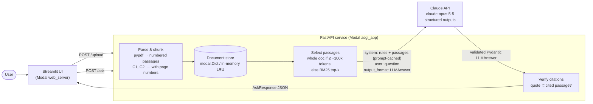
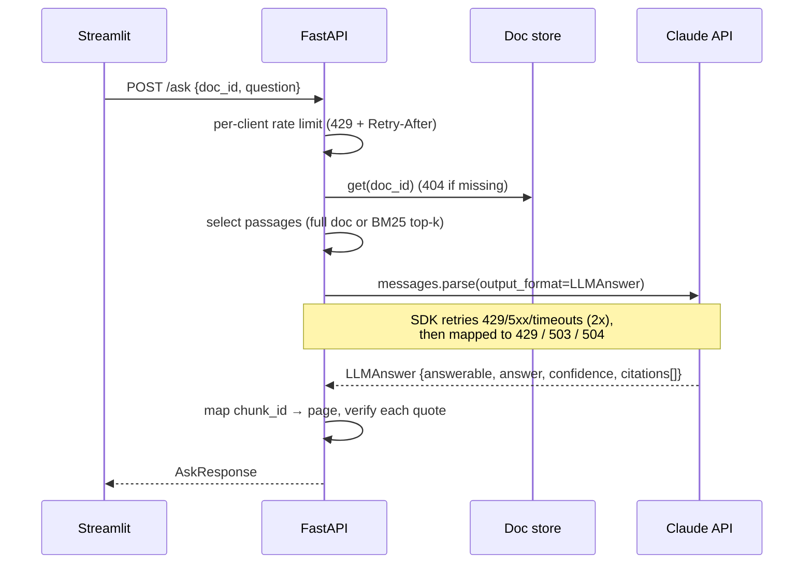

# DocQA: document Q&A with verified citations

Upload a PDF or text file, ask a question, and get a structured answer in which every claim points to a page and quotes the passage it came from. Each quote is then checked against the source text on the server, so a citation the model made up shows up as unverified.

**Live demo:** [UI](https://alizaimoiz6--docqa-ui.us-east.modal.run) · [API docs](https://alizaimoiz6--docqa-api.us-east.modal.run/docs) (it may take a few seconds to wake up after being idle)

    

## Architecture



**Request flow for `/ask`**



## API

| Method | Path | Body | Returns |
|---|---|---|---|
| `POST` | `/upload` | `multipart/form-data` field `file` (`.pdf`, `.txt`, `.md`; ≤ 20 MB) | `doc_id`, page/passage counts |
| `POST` | `/ask` | `{"doc_id": "...", "question": "..."}` | `AskResponse` (below) |
| `GET` | `/health` | – | status and model |
| `GET` | `/docs` | – | Interactive OpenAPI docs |

```bash
API_URL=https://alizaimoiz6--docqa-api.us-east.modal.run
curl -F file=@sample_docs/acme_policy.pdf $API_URL/upload
# {"doc_id":"ff5962535418","filename":"acme_policy.pdf","kind":"pdf","pages":3,"chunks":3,"characters":324}

curl -H 'content-type: application/json' \
     -d '{"doc_id":"ff5962535418","question":"When must claims be filed, and what is the ER copay?"}' \
     $API_URL/ask
```

Real response from the sample PDF (note `cache_read_input_tokens`: the document came from the prompt cache):

```json
{
  "doc_id": "776e6674b032",
  "question": "When must claims be filed, and what is the ER copay?",
  "answerable": true,
  "answer": "Claims must be submitted within 90 days of the date of service; late claims are denied unless the member shows good cause. The emergency room copay is $150, which is waived if the member is admitted to the hospital.",
  "confidence": "high",
  "citations": [
    {"chunk_id": "C2", "page": 2, "quote": "Claims must be submitted within 90 days of the date of service.", "verified": true},
    {"chunk_id": "C2", "page": 2, "quote": "Late claims are denied unless the member shows good cause.", "verified": true},
    {"chunk_id": "C3", "page": 3, "quote": "Emergency room visits have a $150 copay that is waived if the member is admitted to the hospital.", "verified": true}
  ],
  "retrieval": "full_document",
  "model": "claude-opus-5-5",
  "usage": {"input_tokens": 23, "output_tokens": 210, "cache_read_input_tokens": 1091},
  "latency_ms": 2374
}
```

A question the document can't answer returns `answerable: false` and no citations:

```json
{"question": "Does the policy cover dental cleanings?", "answerable": false, "confidence": "high", "citations": [],
 "answer": "The document doesn't say whether dental cleanings are covered. It only addresses outpatient visit copays, claim submission deadlines, and emergency room copays."}
```

### Errors

Every error has the same shape: `{"error": "<code>", "detail": "<message>"}`.

| Status | When |
|---|---|
| `404 not_found` | Unknown `doc_id` |
| `413 payload_too_large` | Upload over `MAX_UPLOAD_MB`, or document too large for the model |
| `415 unsupported_media_type` | Not a PDF or text file |
| `422 unprocessable` | Empty file, scanned PDF without a text layer, encrypted PDF, bad question, or the model declined |
| `429 rate_limited` | Client exceeded `ASK_RATE_LIMIT_PER_MIN`, or Claude rate-limited us after retries. Includes `Retry-After` |
| `502 upstream_error` | Network failure reaching Claude, or an incomplete answer |
| `503 upstream_unavailable` | Claude 5xx / overloaded after retries |
| `504 upstream_timeout` | Claude call exceeded `ANTHROPIC_TIMEOUT` after retries |

## Design decisions

- **Structured outputs over free text.** `client.beta.messages.parse(output_format=LLMAnswer)` constrains Claude to a JSON schema generated from a Pydantic model, so the response is always valid and typed. There's no regex parsing and no "please reply in JSON".
- **Citations the server can check.** Claude's native Citations feature can't be combined with structured outputs (the API rejects the pair). Instead, the document is sent as numbered `<passage id="C7" page="3">` blocks and the schema asks for `{chunk_id, quote}` pairs. The server maps each `chunk_id` back to its page and confirms the quote appears in that passage, ignoring case, whitespace and `...` elisions. Unverified citations are still returned, flagged `verified: false`, so the UI can warn about them.
- **Long-context first, retrieval as a fallback.** Claude Opus 5.5 has a 1M-token window, so documents up to about 100k tokens are sent whole: nothing gets missed and there's no embedding infrastructure to run. Larger documents are narrowed to the top 40 passages by BM25, a dependency-free lexical ranker. `retrieval` in the response says which path ran.
- **Prompt caching.** The document is placed in the system prompt with a `cache_control` breakpoint, so follow-up questions on the same document read it from cache instead of paying full input cost again.
- **"I don't know" is a first-class answer.** `answerable: false` lets the model say the document doesn't cover the question, rather than inventing an answer.
- **Failure handling in two layers.** The Anthropic SDK retries 429, 5xx and timeouts with exponential backoff. Whatever still fails is mapped to an HTTP status the client can act on, with the upstream `Retry-After` passed through. A per-client sliding-window limiter protects the API key on the public URL. Server-side refusal fallback is enabled, so a safety-classifier decline is retried on a suitable model before the request fails.

## Run locally

Requires Python 3.10+ and an [Anthropic API key](https://console.anthropic.com/).

```bash
python3 -m venv .venv && source .venv/bin/activate
pip install -r requirements-dev.txt
export ANTHROPIC_API_KEY=sk-ant-...

uvicorn docqa.server:app --reload --port 8000          # API at http://localhost:8000/docs
streamlit run frontend/streamlit_app.py                 # UI at http://localhost:8501 (in a second terminal)
```

Sample documents are in [`sample_docs/`](sample_docs).

### Tests

```bash
pytest
```

The 26 tests cover upload validation, chunking, BM25 selection, quote verification, rate limiting, and mapping each Anthropic SDK exception to an HTTP status. Claude is stubbed out, so the suite runs offline and costs nothing.

## Deploy to Modal

```bash
pip install modal && modal setup                                   # one-time browser login
modal secret create anthropic-secret ANTHROPIC_API_KEY=sk-ant-...
modal deploy modal_app.py
```

Modal prints two public URLs: `https://<workspace>--docqa-api.modal.run` (FastAPI) and `https://<workspace>--docqa-ui.modal.run` (Streamlit). The UI finds the API URL automatically. Uploads are stored in a `modal.Dict`, so any container can answer questions about any upload, and containers scale to zero when idle.

## Configuration

| Variable | Default | Purpose |
|---|---|---|
| `ANTHROPIC_API_KEY` | – | Required |
| `ANTHROPIC_MODEL` | `claude-opus-5-5` | Model ID |
| `ANTHROPIC_EFFORT` | `medium` | `low` / `medium` / `high` / `xhigh` / `max`. Trades depth for latency and cost |
| `ANTHROPIC_TIMEOUT` | `90` | Seconds per Claude request |
| `ANTHROPIC_MAX_RETRIES` | `2` | SDK retries for 429/5xx/timeouts |
| `MAX_UPLOAD_MB` | `20` | Upload size cap |
| `CONTEXT_CHAR_BUDGET` | `400000` | Above this size, switch from whole document to top-k passages |
| `TOP_K_CHUNKS` | `40` | Passages sent in top-k mode |
| `ASK_RATE_LIMIT_PER_MIN` | `10` | Per-client `/ask` limit |
| `DOCQA_STORE` | `memory` | `memory` or `modal` |
| `API_URL` | `http://localhost:8000` | Where the Streamlit UI sends requests |

## Project layout

```
docqa/
  main.py        FastAPI app factory, routes, error handlers, rate limiter
  llm.py         Claude call, prompt, SDK-exception → HTTP mapping
  documents.py   PDF/text parsing, chunking, BM25 selection, quote verification
  schemas.py     Pydantic models (Claude's output contract + API responses)
  store.py       In-memory LRU and modal.Dict document stores
  config.py      Environment-driven settings
frontend/streamlit_app.py
modal_app.py     Modal deployment (API + UI)
tests/
```

## Limitations and next steps

- Scanned PDFs have no text layer and are rejected. Adding OCR, or sending the PDF to Claude as a `document` block, would cover them.
- The rate limiter is per container. A shared store such as Redis or `modal.Dict` would make it global.
- Uploaded documents are not encrypted at rest and never expire. Add a TTL and auth before handling sensitive data.
- Next: streaming answers, multi-document questions, and an evaluation set that measures citation precision.
